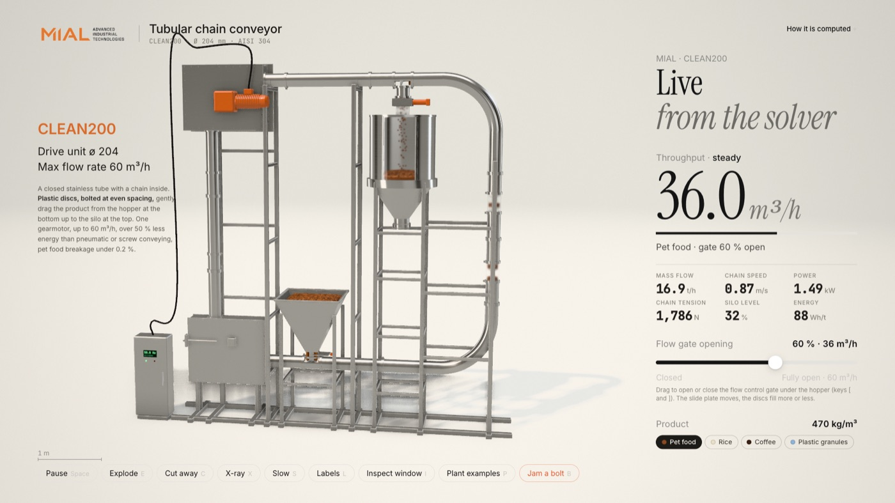
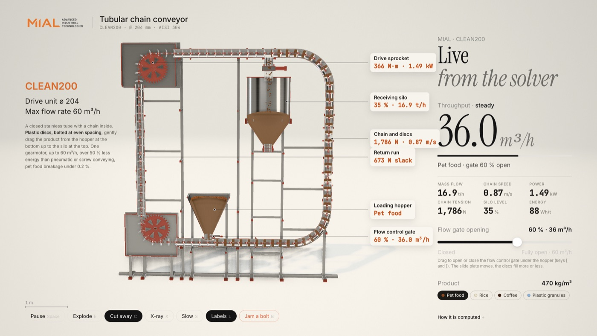
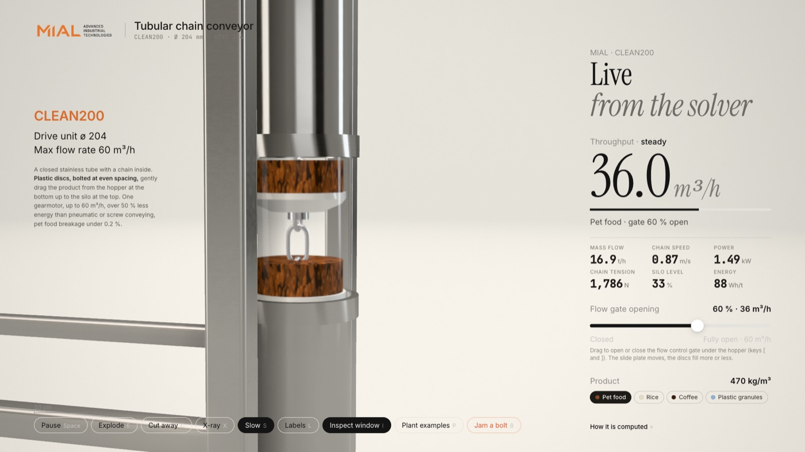

# Massini Industries 3D simulators: MIAL conveyor and MF TECNO Trio Line

`index.html` is the Massini landing page (assets in `landing/`, scenes in `landing/scene.js`; it links to the simulators). `simulazioni.html` is a simple chooser with two cards: **MIAL** (`mial.html`, the CLEAN200 tubular chain conveyor, described below) and **MF TECNO** (`mftrio.html`, the MF Trio Line: MF 54 vertical packaging machine, MF Smart Palletizer and MF Wrap 35 stretch wrapper). Both simulators have the same controls and a small switcher at the top.

## MIAL tubular chain conveyor: interactive 3D simulator (CLEAN200)

A single-page, physics-driven 3D model of the MIAL **CLEAN200** tubular chain conveyor (drive unit ø 204, up to 60 m³/h): a closed stainless tube with plastic discs bolted to a chain that lifts bulk product from a loading hopper at the bottom to a silo at the top. Every number on screen is computed by a small solver, not typed in.



| Cut-away with live values | Inspecting a sight window |
|---|---|
|  |  |

A 49 s film of the model is in [`video/tubular-chain-conveyor.mp4`](video/tubular-chain-conveyor.mp4).

## Open it

Double-click `index.html` and pick a line, or open `mial.html` / `mftrio.html` directly (each one a self-contained file; it loads three.js 0.170 and the Google Fonts from their CDNs, so it needs an internet connection).

## What you can do

- **Flow gate opening** (slider, or keys `[` and `]`): opens the flow control gate under the hopper, 0 to 60 m³/h. The discs fill more or less, the throughput and all KPIs follow.
- **Product** (key `M` cycles): the ten products of the brochure. Food: malt, cereals, dried fruit, rice, coffee. Non-food: pet food, feed, pellets, plastic granules, chemicals. Each has its own look, bulk density, wall friction and grain size, so tonnes per hour, power and chain tension change.
- **Modes**: Explode `E`, Cut away `C`, X-ray `X`, Slow motion `S`, Labels `L`, Pause `Space`.
- **Inspect window** `I`: zooms to a riser sight glass in slow motion to see discs, chain and product climb.
- **Plant examples** `P`: gallery of the plant layouts from the brochure (pages 9 and 13).
- **All models and specs** `D`: CLEAN200 / 159 / 100 and CHAINMOVE159 / 100 / 60 at a glance.
- **Jam a bolt** `B`: a steel bolt wedges between a disc and the first bend. It needs about 4.9 kN to crush through; the drive can pull about 3.4 kN at its 150 % torque limit, so the chain stalls and the inverter trips after 2 s. The chain itself stays far from its breaking load (about 4 kN against roughly 36 kN).
- **FAQ** `F`: the five questions of the MIAL product page (answers condensed) and five about this simulator.
- **How it is computed**: the model in plain words, with the equations.

## What is computed

- Flow `Q = min(gate setting, A·φ·v)`, fill factor φ = 0.64, bore area from the 204 × 4 mm tube.
- Chain speed from inverter frequency, slip, gearbox ratio and sprocket radius.
- Chain tension walked round the 16.7 m loop (friction of chain and product, 4.45 m lift, capstan gain on the bends); take-up fixed at the wheel; drive force = tight side − slack side.
- Hopper outlet limit by Beverloo's law; silo level integrated from inflow and a fixed outlet draw.
- Power from drive force, speed, gearbox and motor efficiency.

**Taken from the brochure:** tube ø 204, plastic discs bolted to the chain, gearmotor on the chain drive, 400 V 50 Hz, up to 7.5 kW, AISI 304, 60 m³/h, hopper with flow control device, unloading with slide gate valve, energy savings over 50 %, pet food breakage under 0.2 %.

**Assumed (not in the brochure):** motor 2.2 kW and 58:1 gearbox, chain wire size, disc and chain masses, friction and bulk density of the four products, sight glasses, silo and hopper sizes, the 2 s inverter trip time, and the wedge force of the bolt. The 3D model shows the CLEAN200 only; the other models appear as specs.

**Source discrepancies:** the website lists "ChainMove200 ø 204, 60 m³/h"; the brochure range pages (14, 15) put 60 m³/h on the CLEAN200 and 30 m³/h on the ChainMove159, and the ChainMove data page (12) is inconsistent. The model follows pages 14 and 15.

## MF Trio Line (`mftrio.html`)

Three machines in sequence, simulated as a queue: the **MF 54** forms and seals bags (slider, up to 20 bags/min), they ride an infeed belt, the **portal palletizer** stands behind the line and its blue cantilever arm picks one bag per 7.2 s cycle (500 cycles/h, so the line tops out at 8.3 bags/min) and stacks them 3 x 2 per layer, a full pallet rolls to the **MF Wrap 35** turntable (35 pallets/h) and is wrapped in stretch film. *Film runs out* stops the wrapper and the whole line backs up. Camera shortcuts `1` to `4` (whole line, MF 54, palletizer, wrapper), `D` specs, `F` FAQ, bag weight 5 / 10 / 20 kg, simulation speed 1x to 12x.

**Taken from the MF TECNO flyer, film and website (mftecno.com/it, checked against the three product pages):** the three machines and their sequence; MF 54 up to 20 bags/min (1200/h), bags of 5 to 20 kg, 230 x 300 to 470 x 680 mm, pillow and gusseted PE bags; palletizer up to 500 cycles/h in the line (its own page, MF PCA Smart Pro, says up to 800), load up to 50 kg, 800 x 1200 and 1000 x 1200 pallets, up to 1800 mm incl. pallet, 4 brushless axes; MF Wrap 35 up to 35 pallets/h, capacity 2000 kg, motorised pre-stretch, automatic cut and weld; single supply, tested integration, immediate delivery, contact details.
**Assumed:** exact bag size (0.40 x 0.40 m), 1 bag per palletizer cycle (as in the flyer photo), 6 bags per layer on a 1200 x 800 pallet (360 kg per pallet at 10 kg), belt 0.5 m/s, turntable 8 rpm, and all the geometry.
**Source discrepancies:** the website home lists the standard line with an "MF 52, up to 80 BPM" bagger; the MF 54 page says 20 BPM, which the model follows. The Wrap 35 page says both "rotating table" and "rotating arm"; the model shows the turntable.

## Repository layout

```
index.html   the chooser (MIAL or MF TECNO)
mial.html    the MIAL simulator
mftrio.html  the MF Trio Line simulator
video/                        the film
docs/                         the MIAL brochure (PDF) and preview images
src/machine.src.js            MIAL: geometry, solver, UI, film
src/trio.src.js               MF Trio Line: geometry, queue simulation, UI
src/chooser.html              the chooser page
src/head.html                 page shell with the inlined lab kit (tools/kit/lab-kit.js)
src/assets/                   MIAL, MF TECNO and Massini logos, card images and the four brochure images, base64
src/assemble.mjs              builds the page from the above
tools/                        screenshot and film recording scripts + the lab kit
```

## Rebuild and record

```sh
node src/assemble.mjs                       # rebuild index.html, mial.html, mftrio.html

cd tools && npm install && npx playwright install chromium   # once; the film also needs ffmpeg
node scripts/shot.mjs ../mial.html ../out/review.png --root ..
node scripts/record.mjs ../mial.html ../video/tubular-chain-conveyor.mp4 --root ..
```

The film is deterministic: the page runs in `?film=1` mode and its clock only moves when the recorder steps it.

## Credits and rights

- Built with three.js. The lab kit and the recording scripts in `tools/` are MIT-licensed, see `tools/LICENSE`.
- The MF TECNO name, logo and flyer image belong to MF TECNO / Massini Industries srl, used here to illustrate the product.
- The MIAL name, logo, brochure text and the plant images (pages 9 and 13) belong to MIAL / Massini Industries srl. They are included here to illustrate the product. This simulator is an independent illustration, not an official MIAL product.
